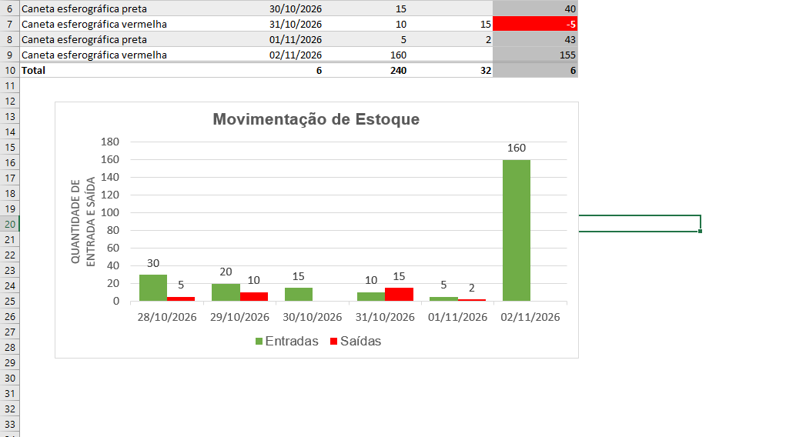

# 📊 Controle de Estoque Simplificado no Excel

Projeto de controle de estoque desenvolvido no **Microsoft Excel**, como parte dos meus estudos e da minha evolução na área de **Análise de Dados**.

O projeto foi realizado acompanhando as aulas e orientações do **professor Nelio Alves, da Udemy**, e me permitiu colocar em prática diferentes recursos do Excel em uma solução integrada.

## 🎯 Objetivo

Organizar o cadastro de produtos e acompanhar a movimentação do estoque, incluindo entradas, saídas, saldos e avisos relacionados aos limites mínimo e máximo definidos para cada item.

## ⚙️ Funcionalidades

- **Início:** página de apresentação e navegação entre as abas.
- **Cadastro:** registro dos produtos, definição de estoque mínimo e máximo, acompanhamento do saldo e avisos para reposição ou priorização de vendas.
- **Lançamentos:** registro de entradas e saídas, acompanhamento de saldos e visualização das movimentações em gráfico.

## 🧠 Recursos praticados

- `SOMASE`: cálculo do saldo de cada produto a partir das entradas e saídas.
- `SOMASES`: cálculo de saldo por produto considerando datas.
- `SE`: exibição de avisos com base nos limites de estoque.
- Validação de dados para selecionar produtos cadastrados.
- Formatação condicional para destacar situações que merecem atenção.
- Tabelas, filtros, hiperlinks entre abas e gráficos.

## 📷 Visualização

▶️ [Assista à demonstração do projeto](demonstracao.mp4)

## 🚀 Como utilizar

1. Baixe o arquivo [`Projeto-Estoque.xlsx`](Projeto-Estoque.xlsx).
2. Abra-o no Microsoft Excel.
3. Na aba **Cadastro**, registre seus produtos e os limites de estoque.
4. Na aba **Lançamentos**, informe as entradas e saídas de cada produto.
5. Consulte os saldos, avisos e gráficos para acompanhar a movimentação.

> **Observação:** projeto educacional, destinado à prática de recursos do Excel. Não é um sistema integrado a banco de dados.

## 📚 Aprendizado

O principal aprendizado foi entender como diferentes fórmulas e ferramentas podem trabalhar juntas. Mais do que calcular valores isolados, pude visualizar como os recursos do Excel ajudam a estruturar e acompanhar informações de forma organizada.

## 👨‍💻 Autor

**David Lucas** — Estudante de Análise e Desenvolvimento de Sistemas, com interesse em Análise de Dados.

GitHub: [David-L-Santos](https://github.com/David-L-Santos)

## 🙏 Créditos

Projeto desenvolvido a partir das aulas e orientações do **professor Nelio Alves, da Educando Web**.
